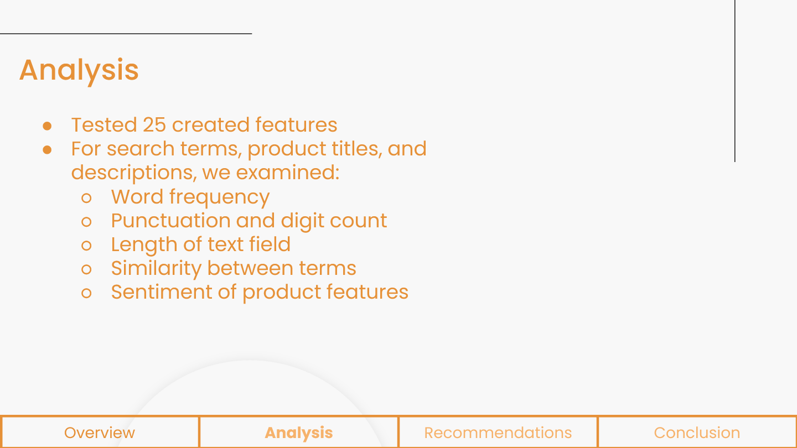
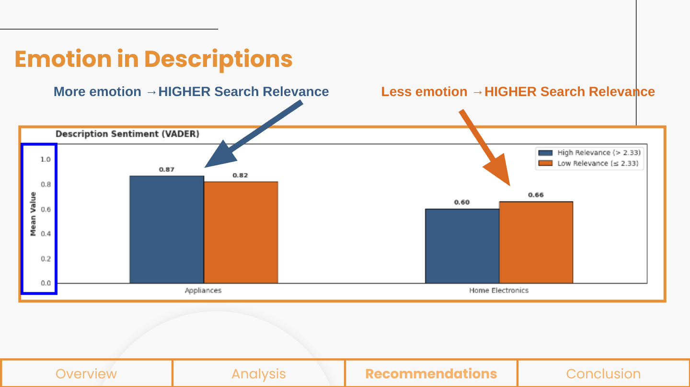
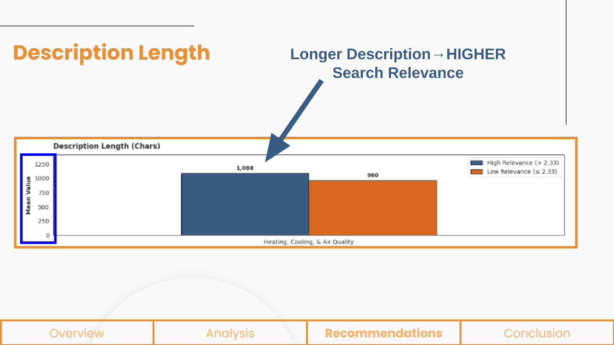
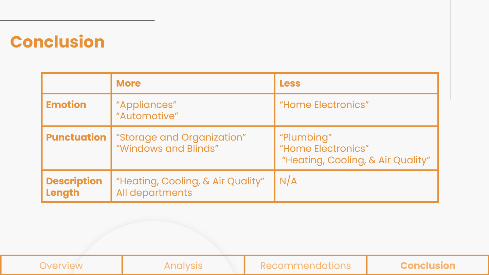

# Nailing Search Relevance

### Home Depot search relevance analysis with NLP

A team project exploring how product titles, descriptions, and attributes relate to the relevance of Home Depot search results. Using the dataset from Kaggle's **Home Depot Product Search Relevance** competition, we studied differences across product departments and developed recommendations for product listing content.


**Team #3:** Josh Paulson, Sathvik Chatta, Ryder Fuscellaro, Andrew Kutsch, and Katie Shapiro

**Presentation date:** October 16, 2026

[Explore the notebook](home_depot_search_relevance.ipynb) · [Download the presentation](NLP_Final_Presentation.pptx) · [Kaggle competition and data](https://www.kaggle.com/c/home-depot-product-search-relevance)

## Project overview

Search relevance measures how well a product matches a customer's query. The dataset provides search–product pairs with human relevance ratings from **1 (not relevant) to 3 (highly relevant)**.

Our class project used this competition dataset to investigate search quality and product content. The focus was interpretable analysis and recommendations for Home Depot leadership. This repository does not document a Kaggle leaderboard submission or a validated relevance prediction model.

We asked:

- Which text features are associated with higher or lower relevance?
- How do those relationships differ by department?
- How could teams adjust product listing content to better support search?

## Approach

1. **Combine product information.** Join labeled search–product pairs with descriptions and aggregated attributes using `product_uid`.
2. **Prepare text and features.** Handle missing values, normalize selected text fields, and calculate text lengths, word counts, punctuation, digit density, and length ratios.
3. **Measure query–product overlap.** Use TF-IDF weighting and cosine similarity to compare queries with product text.
4. **Analyze sentiment.** Calculate VADER sentiment scores for product descriptions and search terms.
5. **Assign departments.** Use the notebook's `HomeDepotClassifier`, which combines prioritized regex rules with a TF-IDF/logistic regression fallback and confidence/margin thresholds.
6. **Compare relevance within departments.** Examine Spearman correlations and differences between high relevance (**> 2.33**) and low relevance (**≤ 2.33**) groups.

The notebook defines 25 continuous features for its main department analysis and includes additional exploratory diagnostics and charts.



## Findings from the presentation

The team's central recommendation was to tailor product content by department rather than apply one writing style across the catalog.

| Content feature | Department observations reported in the slides |
| --- | --- |
| Description sentiment | More positive/emotional language was associated with higher relevance in Appliances and Automotive; Home Electronics showed the opposite recommendation. |
| Title punctuation | Recommendations differed across departments, including Storage and Organization, Windows and Blinds, Plumbing, Home Electronics, and Heating/Cooling. |
| Description length | Longer descriptions were generally recommended, particularly for Heating, Cooling, & Air Quality. |

### Description sentiment varies by department



### Description length and relevance



### Department recommendations



**Interpretation:** These are observational relationships and recommendations from the original project. They do not establish that editing a listing causes an improvement in search relevance. The presentation's headline **19.3%** improvement claim is retained in the original deck; a controlled experiment or independently verified uplift calculation is not supplied here. Department labels also differ between some slide wording and notebook categories, so consult the code when reproducing a department analysis.

## Repository contents

```text
.
├── home_depot_search_relevance.ipynb  # Original team analysis
├── NLP_Final_Presentation.pptx       # Original presentation (33 slides)
├── assignment_brief.html            # Course assignment, for context
├── project-cover.png                # Presentation slide 1
├── feature-engineering.png          # Presentation slide 11
├── sentiment-comparison.png         # Presentation slide 14
├── description-length.png           # Presentation slide 21
├── recommendations.png              # Presentation slide 24
├── requirements.txt
└── .gitignore
```

The notebook and presentation are preserved as supplied. The HTML file is the assignment brief, not a results report. README images were exported from slides 1, 11, 14, 21, and 24 of the supplied presentation.

## Running the notebook

### 1. Set up Python

Use Python 3.10 or later in a virtual environment:

```bash
python -m venv .venv
# Windows PowerShell:
.venv/Scripts/Activate.ps1
# macOS / Linux:
# source .venv/bin/activate
python -m pip install -r requirements.txt
python -m spacy download en_core_web_sm
python -m nltk.downloader vader_lexicon
```

Dependency versions were not recorded in the supplied notebook. `requirements.txt` lists its third-party imports and Jupyter tooling; it is not a tested environment lockfile.

### 2. Download the competition data

Get the files from the [Kaggle competition data page](https://www.kaggle.com/c/home-depot-product-search-relevance/data), following Kaggle's access requirements and competition terms:

- `train.csv`
- `test.csv`
- `attributes.csv`
- `product_descriptions.csv`
- `sample_submission.csv`

Extract the CSV files into a local `data/` directory. Dataset files are not included in this repository.

### 3. Update the input paths

The original notebook uses five absolute Google Drive paths in its second code cell:

```python
'/content/drive/MyDrive/Homework Team #2/NLP Final Project/train.csv'
```

Replace each path with the location of its CSV file. When starting Jupyter from the repository root, `data/train.csv`, `data/test.csv`, and the corresponding paths for the other three files are suitable. Keep the original `encoding='latin-1'` setting.

### 4. Open and run

```bash
jupyter lab home_depot_search_relevance.ipynb
```

Run cells in order. Feature extraction and department classification can take time on the full dataset. Some later exploratory cells assume specific department names or numeric feature columns and may need adjustment for the current dataframe. The full analysis has not been rerun as part of preparing this repository because the competition CSV files were not supplied.

## Credits and sources

Created jointly by **Josh Paulson, Sathvik Chatta, Ryder Fuscellaro, Andrew Kutsch, and Katie Shapiro**. This repository presents the team's shared work and does not assign individual ownership of specific components.

- **Dataset and competition:** [Home Depot Product Search Relevance on Kaggle](https://www.kaggle.com/c/home-depot-product-search-relevance).
- **Project context:** [Original course assignment brief](assignment_brief.html).
- **Presentation:** The original deck includes its source citations and template attribution. Those are preserved in the supplied PowerPoint.

This is an academic project using Home Depot competition data. It is not an official Home Depot product or service. Dataset and third-party presentation assets remain subject to their respective terms. No additional software license has been assigned to the team's work in this upload.
